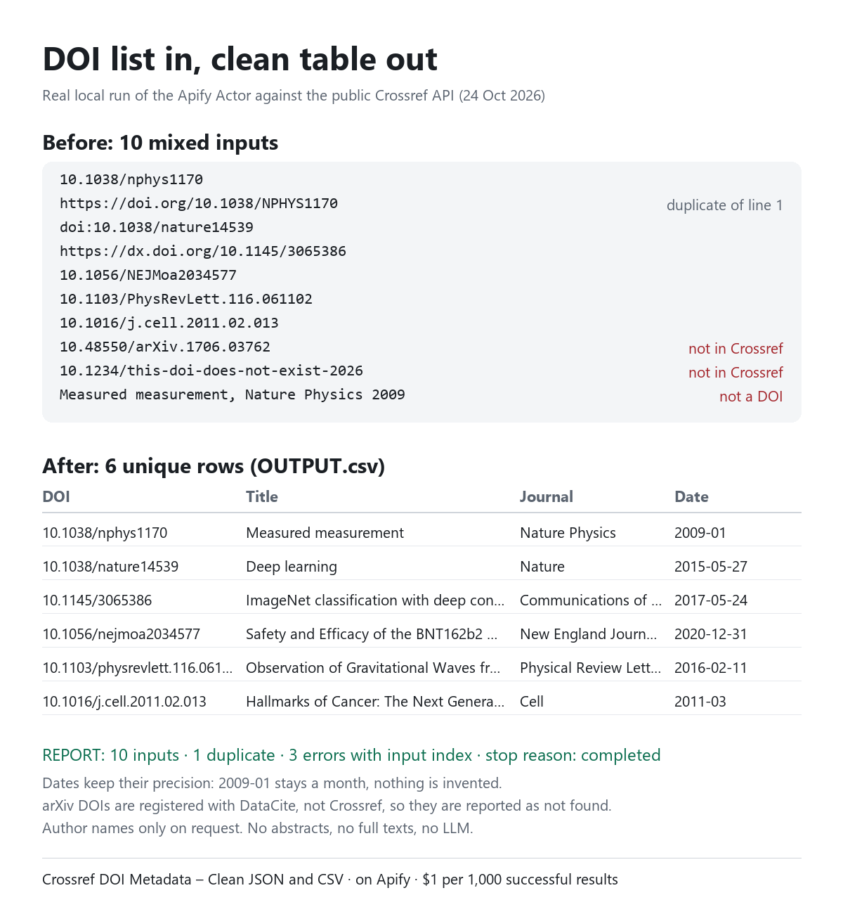

# DOI list to clean CSV with Crossref metadata

Turn a messy list of DOIs into one clean table row per unique DOI: title, journal, publisher, publication type, publication date (with its real precision), reference count and the Crossref source URL. The JSON dataset also carries license links and date parts. Duplicates are counted, and invalid or unknown DOIs are reported with their input position instead of silently disappearing.

This repository is a reproducible example for the Apify Actor [Crossref DOI Metadata – Clean JSON and CSV](https://apify.com/wavy_toucanet/crossref-metadata-pilot).

> **Disclosure:** I publish this Actor on Apify and earn money from paid runs ($0.001 per successful unique result). The Crossref REST API itself is free. If you can write a small script, you can call it directly. See [Do it yourself for free](#do-it-yourself-for-free). This README and the example script were drafted with AI assistance and checked against a real run.

## Before and after



[`input.json`](input.json) contains 10 inputs in mixed formats:

```text
10.1038/nphys1170
https://doi.org/10.1038/NPHYS1170          <- same DOI as line 1
doi:10.1038/nature14539
https://dx.doi.org/10.1145/3065386
10.1056/NEJMoa2034577
10.1103/PhysRevLett.116.061102
10.1016/j.cell.2011.02.013
10.48550/arXiv.1706.03762                  <- arXiv DOI, registered with DataCite
10.1234/this-doi-does-not-exist-2026       <- does not exist
Measured measurement, Nature Physics 2009  <- a citation, not a DOI
```

A local run of the Actor code against the live Crossref API on 24 October 2026 (no Apify platform run, so no charge was measured) produced [`sample-output/OUTPUT.csv`](sample-output/OUTPUT.csv) with 6 rows:

| doi | title | containerTitle | publicationDate |
|---|---|---|---|
| 10.1038/nphys1170 | Measured measurement | Nature Physics | 2009-01 |
| 10.1038/nature14539 | Deep learning | Nature | 2015-05-27 |
| 10.1145/3065386 | ImageNet classification with deep convolutional neural networks | Communications of the ACM | 2017-05-24 |
| 10.1056/nejmoa2034577 | Safety and Efficacy of the BNT162b2 mRNA Covid-19 Vaccine | New England Journal of Medicine | 2020-12-31 |
| 10.1103/physrevlett.116.061102 | Observation of Gravitational Waves from a Binary Black Hole Merger | Physical Review Letters | 2016-02-11 |
| 10.1016/j.cell.2011.02.013 | Hallmarks of Cancer: The Next Generation | Cell | 2011-03 |

and [`sample-output/REPORT.json`](sample-output/REPORT.json) (excerpt):

```json
{
  "inputCount": 10,
  "uniqueValidDois": 8,
  "duplicateCount": 1,
  "emittedCount": 6,
  "errors": [
    { "inputIndex": 9, "code": "invalid_doi" },
    { "inputIndex": 7, "code": "not_found" },
    { "inputIndex": 8, "code": "not_found" }
  ],
  "deferredDois": [],
  "stopReason": "completed"
}
```

`inputIndex` is zero-based, so index 7 is line 8 of the input. The report gives positions, not the DOI strings themselves. A platform run of [`run-actor.mjs`](run-actor.mjs) with the same input on 24 October 2026 returned the same 6 rows, the same report and 6 charged result events.

The CSV has more columns than shown here (`publisher`, `publicationType`, `authorCount`, `referenceCount`, `sourceUrl`, `retrievedAt`, `missingFields`, `warnings`).

Things worth noticing:

- `2009-01` and `2011-03` stay month-precise. No 1 January is invented.
- The arXiv DOI is reported as `not_found`, because arXiv registers its DOIs with DataCite, not Crossref. This Actor only covers Crossref-registered DOIs.
- Author names are left out unless you set `"includeAuthors": true`. `authorCount` is always filled.
- The CSV is spreadsheet-safe: cells that start like a formula are prefixed with an apostrophe.

## Run it without code

1. Open the [Actor page](https://apify.com/wavy_toucanet/crossref-metadata-pilot) and click **Try for free** (an Apify account is required).
2. Paste your DOIs into the **DOIs** field, one per line (up to 500 per run). **Maximum output records** defaults to 100; raise it (up to 500) for longer lists.
3. Start the run. When it finishes, open **Storage → Key-value store** and download `OUTPUT.csv`. `REPORT` lists duplicates and errors. The dataset can also be exported as JSON, CSV or Excel.

## Run it from a script

[`run-actor.mjs`](run-actor.mjs) needs Node.js 18 or newer and no dependencies. It starts a run with a spending cap, waits for it and saves `OUTPUT.csv` and `REPORT.json` in the current directory.

```bash
export APIFY_TOKEN=...            # Apify Console > Settings > API & Integrations
node run-actor.mjs input.json
```

For more than 100 DOIs, set `"maxItems"` (up to 500) and, for long lists, `"maxRunSeconds"` (up to 1800) in your input file. `MAX_CHARGE_USD` caps the charge for one run (default `0.50`, enough for 500 results). Keep your token out of code and version control.

## Cost

- $0.001 per successful unique result ($1 per 1,000). There is no start fee.
- Duplicates, invalid inputs and DOIs that Crossref does not know are not charged.
- At this price the example above would cost $0.006 (6 rows); the local demo run itself was not billed.
- Check the Actor's Pricing tab before a run. Apify plan terms are on [apify.com/pricing](https://apify.com/pricing).

## Limits

- Input is a list of DOI strings: bare DOIs, `doi:` prefixes and `doi.org` / `dx.doi.org` links. It does not resolve free-text citations, titles or PDFs.
- Up to 500 DOIs per run; `maxItems` (default 100, maximum 500) caps the successful rows. Requests are spaced 1.1 seconds apart by default, so 500 DOIs take at least about 9 minutes. The default processing limit is 600 seconds; for long lists raise `maxRunSeconds` (up to 1,800), otherwise the rest is listed in `deferredDois`.
- Data is whatever publishers deposited with Crossref. Missing values stay empty and are listed in `missingFields`.
- A DOI match says nothing about a paper's quality, authenticity or whether it supports a claim.
- No abstracts, full texts, affiliations or email addresses.
- Not affiliated with or endorsed by Crossref.

## Do it yourself for free

Crossref's [REST API](https://www.crossref.org/documentation/retrieve-metadata/rest-api/) is open and needs no key:

```bash
curl -s https://api.crossref.org/works/10.1038/nphys1170
```

For your own scripts, follow Crossref's etiquette: identify yourself with a `mailto` parameter or User-Agent, stay within the published rate limits and handle HTTP 429. The Actor is for people who would rather not write and maintain that, or who want the same output format, duplicate/error report and CSV every time.

## Feedback

Missing a field, a format or an input type? Open an issue here or on the Actor's Issues tab. Include the run ID and the affected DOI, never your token.

## License

The example script and files in this repository are released under the [MIT License](LICENSE). The Actor itself is a separate paid service on Apify.
